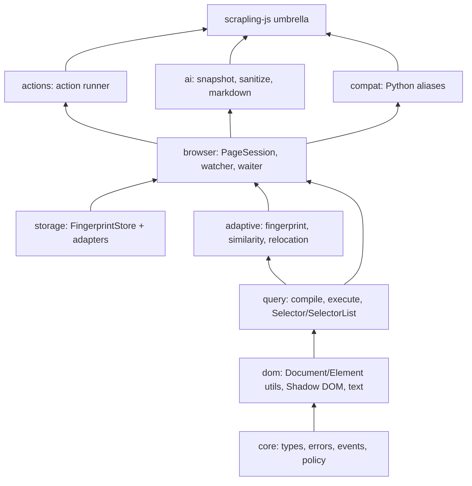

# ScraplingJS Architecture Audit & Product Plan

Status: proposal, 2026-10-27. This document records the current capability surface, the structural problems that keep the repository looking like a ported fork, and the target architecture and phased plan for making it a product.

## 1. Verdict

ScraplingJS is a capable browser-only adaptive DOM library with a real differentiator: it can remember an element, survive markup changes, and keep a selector working across Shadow DOM and SPA mutations. That is a product.

It is not yet a hit, for three reasons:

1. **Identity:** the repository is still mostly the Python upstream. `scrapling/` is 736 KB, `tests/` 1.2 MB, `docs/` 8.5 MB and `agent-skill/` 436 KB; 166 tracked Python files vs 46 tracked TypeScript files (39 of them in `src/`). The release workflow publishes to PyPI, the Dockerfile runs the Python CLI, `ROADMAP.md` is the Python roadmap, and `package.json` literally says "port of Scrapling". History is 1,683 upstream commits vs a handful of JS commits. Visitors see a fork, not a new project.
2. **API:** the public surface is a translation of Python, not a TypeScript design. Snake_case aliases, `__str__`/`__repr__`, `TextHandler extends String`, `Selectors extends Array`, `Selector` attribute access through a `Proxy`, and overloaded `find`/`findAll`/`css`/`xpath` returning different shapes all leak the original design. A new user cannot tell which API is canonical.
3. **Packaging and proof:** one 173 KB ESM entrypoint, no subpath exports, no CJS/IIFE build, no Chrome extension starter, no real-site benchmark corpus, no coverage, no Node/SSR story, and documentation that links to `file:///Users/...` and claims benchmark numbers that omit the 6/9 extreme case.

The fix is not "more features". It is a smaller, sharper product with a canonical TypeScript API, explicit platform boundaries, and a demo that proves the differentiator.

## 2. What the project can do today

### 2.1 Verified capability surface

| Area | What works | Where |
|---|---|---|
| DOM parsing | HTML string, `Uint8Array`, `Element`, `Document`, `ShadowRoot`, `Node`; comment stripping; pretty print | `src/parser/html-loader.ts`, `src/parser/selector.ts` |
| CSS queries | CSS-to-XPath compiler, `::text`, `::attr`, `:contains`, `:not`, `:nth-child`, comma splitting, single-pass `$var` interpolation (an inserted value is never re-scanned); native `querySelectorAll` fast path when the scope holds no shadow roots, translator as fallback and syntax authority | `src/core/translator.ts`, `src/parser/query-runner.ts`, `src/parser/selector.ts` |
| XPath queries | XPath 1.0 execution across open ShadowRoots with deduplication; `//` expressions are scoped to an element-rooted selector for every top-level union branch; one shared shadow-context scan per `css()` call across comma-group parts | `src/parser/query-runner.ts`, `src/core/shadow-dom.ts` |
| Traversal | parent, children, siblings, next/previous, ancestors, descendants, Shadow DOM and slot piercing | `src/parser/dom-traversal.ts`, `src/core/shadow-dom.ts` |
| Extraction | direct text, all text with tag/visibility filters, attributes, HTML, JSON, regex extraction | `src/parser/selector.ts`, `src/core/text-handler.ts`, `src/core/attributes-handler.ts` |
| Search | `findAll` by tag/attributes, text search, regex search, similar-element search | `src/parser/element-finder.ts` |
| Fingerprints | tag, attributes, direct/all text, path, parent, siblings, children, semantic attrs, stable classes, depth, sibling index, optional rect | `src/core/storage-tools.ts`, `src/types.ts` |
| Adaptive relocation | weighted similarity, tag-first two-pass scan with a semantic-tag-change confidence gate, highest-score group, threshold policy, never-target tag prefilter, fingerprint prepared once per scan, `ignoreAttributes` applied to scoring, `pierceShadow` honored, shared by `Selector` and `PagePersistenceManager` | `src/core/relocator.ts`, `src/core/similarity.ts` |
| Persistence | domain-scoped LRU memory keyed by registrable domain (ports preserved for `localhost`/IPs, extension ids preserved for `chrome-extension://`), capacity-aware bucket sharing, domain-scoped `clear()`, custom save/read/hydrate/onError predicates, merge-only hydration, write-behind async saves, flush/close | `src/storage/base.ts`, `src/storage/memory.ts`, `src/core/text-utils.ts` |
| Page sessions | capture/remember/restore, resolve/find/findAll, onRelocate telemetry, mutation watch with debounce, debounced waitFor/waitUntil with 200 ms fallback polling, destroy | `src/persistence/page-persistence.ts` |
| Browser actions | click/double-click, move, wheel, textbox, checkbox, radio, combobox, press key, wait time/element/load; validation; AbortSignal; native React-compatible setters | `src/actions/browser-actions.ts` |
| AI snapshot helpers | open-shadow-root snapshot, hidden-content sanitizer (`hidden` on any tag, `visibility:collapse`), HTML-to-Markdown with images and tables, escaped pretty print with void tags, snapshot search | `src/snapshot/*`, `src/parser/html-loader.ts` |
| Ergonomic facade | callable `scrapling`, `all`, `in`, text/texts/attr, click/fill/check, waitFor/waitUntil, watch, onRelocate, configure, markdown, remember/capture/restore | `src/persistence/easy.ts`, `src/persistence/scoped.ts` |
| Runtime boundary | `DomAdapter` (`parseHtml`, `evaluateXPath`, `createObserver`, node-kind predicates) with a browser default, a global registry and a per-instance `dom` option; actionable errors when neither an adapter nor browser globals exist | `src/core/dom-adapter.ts`, `src/parser/html-loader.ts`, `src/parser/query-runner.ts` |
| Node / Puppeteer | `await Selector.fromHandle(handle)` snapshots a Puppeteer/Playwright `ElementHandle` into an offline `Selector`; linkedom + xpath reference adapter; 33 Node-runtime tests | `src/parser/element-handle.ts`, `test/node/`, `vitest.node.config.ts` |
| Quality gates | strict TypeScript, 120 browser tests, 33 Node tests, `typecheck` + `typecheck:test` + build, synthetic migration benchmark, 17 SHA-pinned GitHub Actions refs | `test/`, `test/node/`, `test-bench/`, `tsconfig.test.json`, `.github/workflows` |

### 2.2 Current constraints

- **Adapter-portable, browser-first.** HTML parsing, XPath evaluation and mutation observation now go through `DomAdapter`; Node needs `parseHtml` + `evaluateXPath` and, only for `watch()`, `createObserver`. Remaining global dependencies: element-vs-fingerprint checks use structural `nodeType` (no `Element` global), but visibility still reads `ownerDocument.defaultView.getComputedStyle` + `getClientRects`, actions dispatch synthetic events, and `src/snapshot/shadow-dom.ts` defaults to a global `document`.
- **Sync-first storage with an async escape hatch.** Queries are synchronous, but `StorageSystem.retrieve` may return a Promise and then throws an "unhydrated" error. Users must remember to `await hydrate()` before any query. This is a leaky contract.
- **Global cache singleton.** `globalBuckets` is module state keyed by `storageFile`; managers of the same file and capacity share it, while a different requested capacity gets a private bucket. `clear()` only removes the current base-domain prefix, but tests still need `clearAll()` between files.
- **One entrypoint.** `exports` has only `"."`. Importing `isElementVisible` ships the whole 173 KB bundle; there is no `./query`, `./storage`, `./actions`, or `./compat`.
- **Dual API.** Every core concept has a camelCase and a Python alias. `Selector` returns `TextHandler` objects that mostly behave like strings; `Selectors extends Array` has a manually repaired prototype; `Proxy` attribute access is untyped and collides with real methods.
- **No product proof.** No MV3 extension, no real-site corpus, no trace/devtools view, no Node example, no live playground, no API reference generated from types.
- **Two CSS execution paths by design.** `css()` prefers native `querySelectorAll` when the scope contains no shadow context roots and falls back to XPath otherwise, so the CSS engine — not the translator — is authoritative for selectors both accept. The translator still decides validity, which keeps the error surface identical across scopes.
- **Fork residue.** Python docs site, 416 Markdown files, Python tests, `pyproject.toml`, `tox.ini`, PyPI release, Python Dockerfile, Python roadmap, stale `TEST_READY.md`, absolute local links in `README.md`.

## 3. What the project should become

**Positioning:** the resilience layer for browser-extension DOM automation. "Your selectors break when the site changes; ScraplingJS keeps them working." The primary user is a Chrome/Firefox extension developer, content-script author, or SPA automation engineer who already has Playwright/Selenium for tests but needs durable selectors in production. AI browser agents are the second audience because they need stable element references and sanitized page context.

**Not the positioning:** a Python port, a full scraping framework, a Playwright replacement, or an everything-library with browser actions, snapshots, AI markdown, and ten storage engines in the root import.

**Design rule:** every module must be useful and testable alone. The parser does not know about persistence; fingerprinting does not know about the DOM watcher; storage does not know about selectors; the ergonomic facade knows about all of them but is thin.

## 4. Target architecture

### 4.1 Package and subpath map

Start with one npm package and explicit subpath exports; split into workspace packages only when the boundaries are proven.

```text
scrapling-js
  .            umbrella: scrapling, createScrapling, createSession
  ./query      Selector, SelectorList, compileCss, compileXPath, text
  ./adaptive   Fingerprint, similarity, RelocationPolicy, relocate
  ./storage    FingerprintStore, MemoryStore, WebStorageStore, ChromeStore
  ./browser    PageSession, watch, waitFor, waitUntil, events
  ./actions    runBrowserActions, validateActions
  ./ai         snapshot, sanitize, markdown, element refs
  ./compat     Python-style aliases, Proxy attributes, TextHandler
```

Rules:

- `./query` has no dependency on storage, watchers, actions, or the facade.
- `./adaptive` depends on query/DOM primitives only; no browser globals beyond an injected `Document`.
- `./storage` depends on types only; no DOM.
- `./browser` composes query + adaptive + storage and owns state.
- `./actions` and `./ai` are optional consumers.
- `./compat` is the only place where Python aliases and Proxy magic live.
- The umbrella package re-exports the canonical API, not everything.

### 4.2 Layers and dependency direction



No lower layer imports a higher layer. No module-level browser globals outside the browser adapter. `PageSession` is the only owner of mutable state.

### 4.3 State ownership

`PageSession` (rename of `PagePersistenceManager`) owns:

- `Document` and URL/domain;
- `FingerprintStore`;
- `RelocationPolicy`;
- active watchers/waiters and their `AbortController`s;
- the typed event bus;
- optional trace collector.

`Selector` and `SelectorList` are immutable values over a node and a query context. They may cache tag/text/attributes locally, but they never own storage, watchers, or global registries.

`MemoryStore` becomes per-session by default. If a shared cache is wanted, pass an explicit `StoreRegistry`; never use module-level `globalBuckets` implicitly. The default `scrapling` facade owns one lazily created session and exposes `resetDefaultSession()` for tests.

### 4.4 Canonical TypeScript API

```ts
import { createSession } from 'scrapling-js'

const session = createSession({
  document,
  url: location.href,
  storage: new MemoryStore({ capacity: 1000 }),
  policy: {
    threshold: 45,
    ignoreAttributes: ['href', 'src', 'id'],
    tagFirst: true,
    includeRect: false,
  },
})

await session.ready() // hydrate async stores before the first query

const cards = session.page().css('.job-card') // SelectorList
const first = cards.first() // Selector | null
const link = first?.find('a.title') // Selector | null
const href = link?.attr('href') // string | null
const text = first?.text() // string
const allText = first?.allText({ separator: '\n' })

const title = await session.restore('job-title') // Element | null
const stop = session.watch('button.apply', { identifier: 'apply-cta' })
const off = session.on('relocate', (event) => {
  console.debug(event.identifier, event.score, event.newFullCssSelector)
})

stop()
off()
await session.destroy()
```

Design decisions:

- **Remove the Proxy** from the canonical `Selector`. Use `attr(name)` and `attributes` map. Keep Proxy only in `./compat`.
- **Replace `TextHandler extends String`** with plain strings in the canonical API. Keep `TextHandler` in `./compat`.
- **Replace `Selectors extends Array`** with `SelectorList` wrapping a readonly array; expose `map`, `filter`, `first`, `last`, `at`, `length`, and iteration. The compat layer can keep the Array subclass.
- **One query result shape:** `css`/`xpath`/`findAll` return `SelectorList`; `find`/`first` return `Selector | null`. `text`/`attr` are explicit extraction methods. No overload that returns `Selector` or `Selectors` depending on a boolean.
- **Typed errors:** `ScraplingError` base with `code`, `cause`, and subclasses `SelectorSyntaxError`, `StoreNotReadyError`, `TimeoutError`, `AbortError`, `UnsupportedRuntimeError`.
- **Typed events:** `session.on('relocate' | 'lost' | 'resolve' | 'error', handler)`, each returning an unsubscribe function. Events carry `score`, `evidence`, `oldFingerprint`, `newElement`, `brokenSelector`, `newFullCssSelector`.
- **AbortSignal everywhere:** `watch`, `waitFor`, `waitUntil`, and actions accept a signal; `destroy` aborts all active work.
- **Trace mode:** `trace?: (entry: QueryTrace) => void` records selector, strategy, candidate count, best score, chosen element, elapsed time. This is the feature that makes self-healing debuggable.

### 4.5 Storage contract

Replace the sync/async union with a snapshot store plus explicit readiness:

```ts
export interface FingerprintStore {
  readonly ready: boolean
  get(key: string): Fingerprint | undefined
  set(key: string, fingerprint: Fingerprint): void
  delete(key: string): void
  hydrate(): Promise<void>
  flush(): Promise<void>
}
```

- The in-memory snapshot is always synchronous.
- External adapters (`localStorage`, `chrome.storage.local`, IndexedDB, remote API) implement `hydrate`/`flush` and write behind.
- `session.ready()` awaits hydration once; querying before readiness throws `StoreNotReadyError`, not an ad-hoc Promise check.
- Keys are namespaced by session/domain explicitly, not by a hidden global bucket.
- TTL/versioning belongs to the store adapter, not the query engine.

### 4.6 DOM platform boundary

Phase 1 does not need a full DOM abstraction. It needs to stop reading globals. Shipped (`src/core/dom-adapter.ts`):

```ts
interface DomAdapter {
  parseHtml(html: string, mimeType?: DomMimeType): Document
  evaluateXPath(
    expression: string,
    contextNode: Node,
    namespaces?: Record<string, string> | null,
  ): XPathNodeSnapshot
  isElement(node: unknown): node is Element
  isDocument(node: unknown): node is Document
  isDocumentFragment(node: unknown): node is DocumentFragment
  isShadowRoot(node: unknown): node is ShadowRoot
  createObserver?(callback: (records: MutationRecord[]) => void): MutationObserverLike
}
```

`browserDomAdapter` is the default; `setDomAdapter()`/`getDomAdapter()` plus a per-instance `dom` option cover global and scoped injection. Native CSS matching is optional at the adapter seam: it is attempted through the root element itself (`querySelectorAll`/`matches`, with every union branch prefixed by `:scope` for element-rooted selectors) and skipped when the adapter lacks it or the selector throws, in which case XPath runs through `evaluateXPath`. Still open: `getComputedStyle`/layout metrics stay outside the adapter (they are read through `element.ownerDocument.defaultView`, so they follow the injected document), `runBrowserActions` remains DOM-only (it accepts the same `dom` adapter option), and generic XPath engines need an explicit hint (`isHtml: true` or `allowAnyNamespaceForNoPrefix: true`) for unprefixed name tests — see the reference adapter in `test/node/support/linkedom-adapter.ts`.

### 4.7 Fingerprinting and relocation

- Keep fingerprints as a versioned data format: `{ v: 2, tag, attributes, text, path, parent, siblings, children, semantic, stableClasses }`. Do not depend on `rect` by default; layout reads are expensive and often zero in hidden tabs.
- Move score weights and ignore lists into `RelocationPolicy`, not scattered constants.
- Return evidence from scoring: tag match, attribute similarity, text similarity, path depth, sibling index. `onRelocate` and trace mode should show why a candidate won.
- Cache `collectDeepElements` per mutation epoch; invalidate on `MutationObserver` callbacks. This is the difference between a demo and a production library on large DOMs. Not done yet: relocation still walks the scope per scan; the shipped wins are a prepared fingerprint per scan, the never-target tag prefilter and the difflib-faithful matcher (autojunk cutoff + pooled typed-array scratch, exact ratio parity with Python `difflib` on 200 randomized pairs).
- Cap candidate scans (`maxCandidates`) and expose a deterministic fallback policy.

### 4.8 Actions and AI

- `./actions` is optional. It should not shape the core API or the root bundle.
- `./ai` should not be "HTML to Markdown" only. The valuable primitive is a **stable element reference**: snapshot an element/subtree, assign refs, sanitize hidden/injected content, return Markdown/JSON plus a `resolveRef(ref)` function. That is what browser agents need.
- Do not add an LLM SDK dependency. Return data and adapters; let users bring their model.

## 5. Repository plan

### Phase 0 — credibility (1 week)

- Move the Python upstream to `legacy/python/` or a separate `upstream-python` branch/repository. Keep `NOTICE`/upstream attribution. Remove Python CI, PyPI release, Dockerfile, Python docs, Python tests, `agent-skill/`, `pyproject.toml`, `tox.ini`, and zensical configs from the main tree.
- Rewrite `README.md` for the TS product only: no "port", no local `file://` links, honest benchmark table including the extreme 6/9 result.
- Replace `ROADMAP.md` with the JS roadmap; delete or rewrite stale `TEST_READY.md`.
- Add `ARCHITECTURE.md` (this file), `CONTRIBUTING.md`, `SECURITY.md`, `CODE_OF_CONDUCT.md`, issue templates, and a support policy.
- Complete `package.json`: `keywords`, `author`, `bugs`, `funding`, `engines`, `exports` for `./package.json`, `publishConfig.provenance`, and a clear `description`.
- CI: typecheck, build, browser tests, Node import smoke test, `npm pack` smoke test, bundle-size budget, and Biome (or ESLint) formatting/lint.

Exit criteria: a fresh clone looks like a TypeScript project; `npm pack` contains only intended files; no Python path is required to build, test, or publish.

### Phase 1 — core boundaries (2–3 weeks)

- Add subpath exports and enforce the dependency graph with an import-boundary check.
- Extract `PageSession`, `SelectorList`, `RelocationPolicy`, typed errors/events, and `FingerprintStore`.
- Remove browser globals from `query`, `adaptive`, and `storage`; inject the platform into `browser`.
- Move all Python aliases and Proxy behavior into `./compat`; deprecate them with a clear removal major.
- Make storage hydration explicit via `session.ready()`; remove the Promise-return guard from the hot path.
- Replace module-level `globalBuckets` with per-session stores and an explicit registry.
- Add trace hooks and candidate-count/latency instrumentation.

Exit criteria: `./query` can be imported and unit-tested without a browser or storage; `./browser` can be constructed with an injected document; no import cycles; root bundle budget met.

### Phase 2 — the wedge (3–5 weeks)

- Ship a Chrome MV3 starter: content script, service worker, `chrome.storage.local` adapter, SPA navigation handling (`pushState`, `popstate`, `pageshow`), iframe support, Shadow DOM demo.
- Publish a live demo: a page that changes its markup, a selector that heals, and a trace panel showing scores.
- Build a real-world fixture corpus from public page snapshots (versioned HTML, not live scraping) and report survival, latency, memory, and false positives.
- Add a devtools-style trace viewer or a lightweight overlay in the demo.
- Write the "Resilient selectors for browser extensions" guide and a comparison with Playwright/Cypress/Cheerio.

Exit criteria: a developer can install the package and have a working MV3 content script in under 15 minutes; the demo proves recovery visually; the benchmark reports honest numbers including failures.

### Phase 3 — growth (ongoing)

- `./ai`: stable element refs, sanitized Markdown/JSON, `resolveRef`, prompt-injection-safe snapshot policy.
- Optional Playwright locator adapter and React/Vue bindings, each as a separate package, not core.
- Docs site with generated API reference, recipes, migration guide from Python, and a playground.
- Release automation with Changesets, npm provenance, GitHub releases, and a support window.
- Community: discussions, good-first-issues, adapter contributions, case studies.

## 6. What to stop doing

- Stop adding Python aliases to core. Freeze them in `./compat`.
- Stop expanding `runBrowserActions` into a Playwright competitor. Keep it optional and small.
- Stop adding storage engines before the store contract is async-correct and per-session.
- Stop claiming 100% recovery without publishing the full matrix and the failures.
- Stop treating the Python tree as the main project. It is upstream reference, not the product.

## 7. Success metrics

A reasonable "hit" for this niche:

- 1,000+ GitHub stars and 2,000+ weekly npm downloads within two quarters.
- Three public case studies from extension/automation teams.
- ≥90% recovery on the real-world corpus, with <1% false positives and p95 query latency <5 ms on a 10k-element page.
- Core subpath bundle <15 KB gzipped; root bundle <40 KB gzipped.
- Zero critical security issues; all watchers abortable; no leaked observers in tests.
- New contributor can run tests and ship a patch in one day.

## 8. Risks and decisions

- **Renaming:** `scrapling-js` carries upstream recognition but also fork baggage. Recommendation: keep the npm name for continuity, but make the README, description, and docs unambiguously about the TypeScript product; revisit a rename only if the fork association blocks adoption.
- **Node support:** the browser-extension wedge does not need Node on day one. Adding a half-working Node adapter would dilute the promise. Ship browser-first; add Node when XPath and visibility are genuinely tested.
- **AI hype:** snapshot/Markdown alone is commodity. The differentiator is stable refs plus self-healing resolution. Build that, not another chat wrapper.
- **Compatibility:** keeping Python aliases forever will freeze the bad API. Give `./compat` a deprecation window and a removal major.
- **Shadow-presence caching:** not implemented on purpose. `attachShadow` emits no mutation record, so a cached "this document has no shadow roots" answer would silently hide elements added later. Instead each query runs one allocation-light scan (`collectQueryContextRoots`) that also yields the XPath context roots, and comma groups reuse it.
- **Universal type-positional pseudos in a shadow scope:** XPath 1.0 cannot express "first sibling with the same tag as the context node" — `current()` is XSLT-only and both Chrome's `document.evaluate` and the `xpath` package reject it. Terminal wildcard compounds (`.item:first-of-type`, `*:nth-of-type(2n+1)`, `:last-of-type`) are therefore stripped from the selector and post-filtered against same-tag sibling indexes for both query paths. A type-positional pseudo in a non-terminal compound (`.item:first-of-type > span`) still falls back to first-child semantics on the XPath path; the native CSS fast path is exact whenever the scope has no shadow roots. Supporting that case needs per-step candidate filtering, not a different XPath expression.

## 9. First three concrete tasks

1. Split the repository identity: move the Python tree to `legacy/python/` (or a separate branch), update CI/docs/metadata, and make `README.md` a TypeScript product page.
2. Introduce subpath exports and the `PageSession`/`FingerprintStore` contracts from §4.3–4.5, keeping behavior identical under tests.
3. Build the MV3 starter and the live healing demo; use it to validate the API before adding more features.
